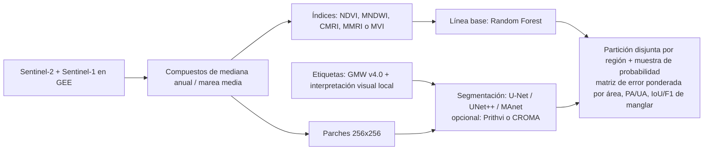

# Estado del arte en monitoreo de manglares con teledetección y aprendizaje automático

**Equipo 5, Ciencias de la Computación. Proyecto final de Machine Learning.**

**Integrantes:** Rachel Mojena González, Jean Manuel Martínez Pardo, Guillermo Hughes Cardona, Camilo Perez Fleita, Mauricio Medina Hernández.

**Resumen.** El monitoreo de manglares desde el espacio se apoya hoy en dos grandes líneas. La primera es operativa y global: **Global Mangrove Watch (GMW)**, un mapa mundial construido con radar y satélites ópticos, cuya versión 3.0 detecta bien dónde hay manglar pero acierta mucho menos al decir dónde se ganó o se perdió (58 % y 61 % de exactitud en esas clases) [1]. La segunda es de investigación: redes neuronales de segmentación (U-Net y sus variantes) entrenadas con imágenes Sentinel-2, con resultados que van de 0,62 a 0,93 de IoU (una medida de solapamiento entre 0 y 1) según lo difícil que sea el conjunto de datos [2][3][4]. Casi todos los conjuntos públicos de entrenamiento usan al propio GMW como etiqueta, así que miden el acuerdo con GMW y no la verdad de campo [2][3][5]. Para detectar cambios y daños dominan las series largas de Landsat y las anomalías de índices de vegetación tras huracanes [6][7][8]. En Cuba hay poca literatura, basada en Landsat, Sentinel-2 y Random Forest en Google Earth Engine [9][10][11].

---

## Guía de conceptos básicos

### ¿Qué es un manglar y qué se quiere medir?

Un manglar es un bosque costero formado por árboles que toleran el agua salada y crecen entre la tierra y el mar, donde sube y baja la marea. Figuran entre los ecosistemas más productivos del mundo y aportan numerosos beneficios ecológicos y socioeconómicos [12]. A escala mundial, Global Mangrove Watch estima unos 147.359 km² en 2020 [1].

Con satélites se hacen tres preguntas, que organizan este documento:

- **Extensión:** dónde hay manglar ahora (sección 4).
- **Cambio:** dónde se ha ganado o perdido manglar con los años (sección 5).
- **Condición:** si el manglar está sano o dañado, por ejemplo tras un huracán (sección 5).

### Imágenes de satélite: píxeles, bandas y resolución

Una imagen de satélite es una cuadrícula de **píxeles**. La **resolución** es el tamaño en el terreno de cada píxel: 10 m en Sentinel-2 [13][14] y 30 m en Landsat [15]. Cada píxel guarda varias **bandas**: medidas de la luz reflejada en distintos rangos de color, incluidos rangos que el ojo no ve, como el infrarrojo cercano (NIR) y el infrarrojo de onda corta (SWIR). La **revisita** es cada cuántos días el satélite vuelve a pasar por el mismo lugar: unos 5 días en Sentinel-2 [13][14] y 16 en Landsat [15].

Como una sola imagen puede tener nubes o una marea desfavorable, se suele combinar muchas imágenes de un año en un **compuesto de mediana**, que toma el valor mediano de cada píxel [16][17].

### Sensores: ópticos y radar

- **Ópticos** (Sentinel-2, Landsat): miden la luz del sol reflejada, como una cámara. Las nubes los bloquean, lo que limita la frecuencia de datos en la costa tropical [6].
- **Radar de apertura sintética (SAR)** (Sentinel-1, ALOS PALSAR): emiten su propia señal y miden lo que rebota, así que no dependen de las nubes [18][19]. La **banda L** (ALOS PALSAR) es la base de Global Mangrove Watch [1][20]; Sentinel-1 usa la banda C [21].

### Índices espectrales

Un índice es una fórmula con las bandas para resaltar una propiedad. El más común es el **NDVI**, (NIR − Rojo)/(NIR + Rojo): valores altos indican más vegetación verde [16]. Como el manglar se parece espectralmente a otra vegetación, existen índices pensados para él (CMRI, MMRI, MVI), descritos en la sección 3. Ningún índice elimina por completo el efecto de la marea [16].

### Aprendizaje automático (ML) aplicado a este problema

En el **aprendizaje supervisado** se le dan al computador ejemplos con su respuesta correcta (las **etiquetas**: "este píxel es manglar, este no") y aprende un modelo que predice la respuesta para zonas nuevas. Aquí la tarea se llama **segmentación**: producir un mapa que marque cada píxel como manglar o no manglar.

- **Métodos clásicos, como Random Forest.** Un conjunto de muchos árboles de decisión sencillos que "votan". Son rápidos y funcionan con pocos datos, pero clasifican cada píxel por separado, lo que puede dejar un mapa con ruido de "sal y pimienta" [18].
- **Aprendizaje profundo, como U-Net.** Redes neuronales con muchas capas. Reciben un **parche** (un recorte de la imagen, por ejemplo de 256×256 píxeles) y devuelven una máscara del mismo tamaño [4][2]. Tienen en cuenta a los píxeles vecinos, pero requieren más datos y cómputo.
- **Preentrenamiento y modelos fundacionales.** Un modelo **preentrenado** parte de lo aprendido en otra tarea y se **ajusta** a la tuya. Los **modelos fundacionales geoespaciales** (Prithvi, CROMA) son modelos grandes preentrenados con imágenes de satélite [22].
- **Etiquetas débiles.** Etiquetas que no son verdad de campo sino un producto existente, como el mapa GMW. Evitan etiquetar a mano, pero el modelo hereda los errores del mapa [2][20].

Los datos se reparten en **entrenamiento** (de donde el modelo aprende) y **prueba** (con lo que se mide qué tal funciona).

### Cómo se mide si un mapa es bueno

- **Exactitud global (OA):** porcentaje de píxeles acertados. Engaña cuando el manglar es poco frecuente: un mapa que dijera "no hay manglar" tendría una exactitud alta.
- **Exactitud del productor (PA):** de todo el manglar real, qué parte detecta el mapa (su complemento es la omisión).
- **Exactitud del usuario (UA):** de lo que el mapa marca como manglar, qué parte lo es de verdad (su complemento es la comisión).
- **IoU:** solapamiento entre la máscara predicha y la real, dividido entre su unión; va de 0 a 1.
- **F1:** un balance entre acertar lo marcado y no dejar manglar sin marcar.

Un punto delicado es la **validación espacial**: si los píxeles de entrenamiento y de prueba son vecinos, el modelo "ya vio" casi lo mismo y su resultado parece mejor de lo real. Por eso se recomienda probar en regiones distintas de las de entrenamiento (sección 8).

### Glosario de siglas

| Sigla | Significado |
|---|---|
| GMW | Global Mangrove Watch, mapa mundial de manglares |
| GEE | Google Earth Engine, plataforma con imágenes y análisis en la nube |
| SAR | Radar de apertura sintética |
| NIR / SWIR | Infrarrojo cercano / de onda corta |
| NDVI, EVI | Índices de vegetación |
| CMRI, MMRI, MVI | Índices específicos de manglar |
| OA, PA, UA | Exactitud global, del productor y del usuario |
| IoU, F1 | Métricas de solapamiento y de balance de aciertos |
| OBIA | Análisis de imágenes orientado a objetos (clasifica regiones y no píxeles sueltos) |
| CCDC, LandTrendr, DECODER | Algoritmos que detectan cambios en series de imágenes a lo largo de los años |
| MANGO, MagSet-2, WaterBench | Conjuntos de datos públicos para entrenar y comparar modelos (sección 2) |
| U-Net, UNet++, MAnet | Redes de segmentación (sección 4) |
| Prithvi, CROMA | Modelos fundacionales geoespaciales (sección 4) |

---

## 1. Contexto del problema

> **En breve.** Hay unos 147.000 km² de manglar en el mundo y se ha perdido una parte pequeña pero real en las últimas décadas, sobre todo por actividad humana. Medirlo desde el espacio es difícil por cuatro motivos: se parece a otra vegetación, la marea cambia la señal, las franjas son estrechas y las nubes tapan la costa tropical.

**Extensión y tendencia.** GMW v3.0 estima unos **152.604 km² en 1996 y 147.359 km² en 2020**, una pérdida neta de alrededor de **3,4 %**. Los intervalos de confianza son muy amplios: el cambio neto (−5.245 km²) tiene un intervalo de −13.587 a +1.444 km², que incluye el cero [1]. La exactitud de las clases de ganancia y pérdida (58-61 %) es muy inferior a la reportada para la extensión [1]. El informe *State of the World's Mangroves 2024* usa GMW v4.0 y cifra **147.256 km²** en 2020. Atribuye el **43 %** de la pérdida 2000-2020 a acuicultura, palma de aceite y arroz, y reporta que cerca del 40 % del manglar está en áreas protegidas [23].

**Causas de pérdida.** Goldberg et al. (2020) calculan 3.363 km² perdidos entre 2000 y 2016 (2,1 % del área global). El **62 %** de esa pérdida fue de origen humano. Las materias primas (arroz, camarón, palma) explican el 47 %, y alrededor del 92 % de esa fracción ocurre en el sudeste asiático. La pérdida humana cayó 73 % entre 2000-2005 y 2010-2016, mientras que el peso relativo de causas naturales (erosión, clima extremo) subió de 34 % a 44 % [24].

**Por qué es difícil desde el espacio.**
(a) El manglar comparte rasgos espectrales con otra vegetación, de modo que un índice de vegetación por sí solo no basta [16].
(b) El nivel de marea cambia la señal espectral, sobre todo donde el rango mareal es grande [16].
(c) Las franjas son estrechas, y los errores aumentan en zonas fragmentadas o cercanas a estanques de acuicultura [1][25].
(d) Las nubes limitan la frecuencia de datos ópticos en la costa tropical [6].

---

## 2. Datos de teledetección y productos existentes

> **En breve.** Los datos básicos son gratuitos: Sentinel-2 y Landsat (ópticos), Sentinel-1 y ALOS PALSAR (radar). Como mapa de referencia se usa GMW. Para entrenar redes existen conjuntos públicos (MANGO, MagSet-2, WaterBench), pero sus etiquetas vienen de GMW.

### 2.1 Sensores

| Sensor | Resolución y cobertura | Uso en manglar | Limitaciones |
|---|---|---|---|
| Sentinel-2 (óptico) | 10 m en las bandas principales, 20 m en red-edge y SWIR; revisita de 5 días; en GEE desde 2017 [13][14] | Sensor principal para mapear extensión actual; base de los conjuntos de aprendizaje profundo [2][3] | Confusión con acuicultura, cultivos de riego y palma [26]; depende de la marea [16] |
| Landsat 5/7/8/9 | 30 m; 16 días; Landsat 8 desde 2013, Landsat 9 desde 2021 [15] | Series largas y detección de cambio [6] | Resolución gruesa en franjas estrechas |
| Sentinel-1 (SAR banda C) | 10/25/40 m según modo; desde 2014 [21] | Complemento independiente de las nubes en la fusión óptico-radar [18][19] | Sentinel-1B falló en diciembre de 2021 [27] |
| ALOS PALSAR / PALSAR-2 (SAR banda L) | Mosaicos anuales de 25 m, 2015-2024 en GEE [28] | Columna vertebral de la serie GMW por su independencia de las nubes [1][20] | Desajuste entre mosaicos y confusión en zonas fragmentadas [1] |

### 2.2 Productos globales

**GMW v3.0** (1996-2020) usa mosaicos de radar de JAXA en 11 épocas (JERS-1 en 1996, ALOS PALSAR en 2007-2010, PALSAR-2 en 2015-2020) [1]. En GEE existe un catálogo comunitario, no oficial, con extensión y cambio [29].

**GMW v4.0 / v4.1.** La línea base 2020 (v4.0) está remapeada con Sentinel-2 a **10 m** [29]. La versión **v4.1.12** (publicada en julio de 2026, licencia CC BY 4.0) cubre 1985-2025 con líneas base quinquenales y mapas anuales. Combina clasificaciones de Landsat y Sentinel-2 (XGBoost y Random Forest en GEE) con radar de banda L. Reporta un **F1 global de 0,9276**, omisión de 6,4 % y comisión de 8,1 %, con 32.569 puntos de referencia en 120 sitios [20]. Estas cifras las informan los propios autores del producto, sin artículo revisado por pares para v4.0/v4.1.

### 2.3 Conjuntos de datos etiquetados

- **MANGO** (Heo et al., 2026): **42.703** pares imagen-máscara de **124 países**, Sentinel-2 de 13 bandas a 10 m, parches de 256×256, con etiquetas de GMW v3.0. Selecciona una sola fecha por sitio y evalúa con partición disjunta por país [2].
- **MagSet-2** (de Souza et al., 2024): **10.483** pares de 128×128 con anotaciones de GMW; su disponibilidad figura como "restringida" [3][2].
- **WaterBench**: tarea binaria de manglar con etiquetas de GMW, Sentinel-1 y Sentinel-2 a 10 m, con una partición de prueba en regiones distintas (Sundarbans, Everglades, Delta del Níger) [5].
- **TorchGeo** (biblioteca de Python) incluye dos conjuntos de datos de manglar: Global Mangrove Distribution (máscaras a 3 m) y CMS Global Mangrove Canopy (biomasa y altura de dosel a 30 m) [30].

---

## 3. Preprocesamiento e índices espectrales

> **En breve.** Antes de clasificar se corrigen las imágenes y se combinan en compuestos anuales para reducir nubes y efecto de marea. Sobre ellas se calculan índices: NDVI y EVI son generales; CMRI, MMRI y MVI se diseñaron para manglar. Ninguno es universal, y todos dependen de la marea y del sitio.

### 3.1 Preprocesamiento

La imagen de una sola fecha tiene poco valor a gran escala porque marea, atmósfera y registro varían; una revisión de 195 trabajos recomienda compuestos anuales de media o mediana sobre series densas [16]. Digital Earth Africa modela la altura de marea en cada adquisición, conserva solo las imágenes de marea media (percentiles 25 a 75) y luego calcula la mediana anual del NDVI [17]. En Brasil, una oscilación aparente de unos 200 km² (cerca de 2 %) en el área anual de manglar se atribuyó a la variabilidad de marea y humedad en los compuestos; los autores recomiendan ventanas multianuales y selección por marea, aunque eso reduce mucho el número de imágenes en zonas nubladas [31].

### 3.2 Índices espectrales

Una revisión de 195 estudios reporta que el **NDVI se usó en 82 %** de ellos y el EVI en 28 %; hay seis índices específicos de manglar publicados hasta 2022 (MRI, MDI, MPVI, CMRI, MFI y MVI) [16].

| Índice | Fórmula | Fuente |
|---|---|---|
| NDVI | (NIR − R)/(NIR + R) | [16] |
| NDWI | (Verde − NIR)/(Verde + NIR) | [32] |
| MNDWI | (Verde − SWIR)/(Verde + SWIR) | Componente de MMRI [31] |
| CMRI | NDVI − NDWI | Gupta et al. 2018 [32] |
| MMRI | (\|MNDWI\| − \|NDVI\|)/(\|MNDWI\| + \|NDVI\|) | Diniz et al. 2019 [31] |
| MVI | (NIR − G)/(SWIR1 − G) | [16] |

- **CMRI.** Probado con Landsat 8 en tres sitios de India con 285 puntos de control. Su exactitud promedio fue **73,43 %**, frente a 56,29 % del NDVI. Los autores reconocen sombreado de terreno, dosel mixto en las periferias y solo tres sitios y un sensor [32].
- **MMRI.** Se evaluó dentro del mapa de manglar de Brasil (Random Forest sobre diez atributos, compuestos anuales 1985-2018, 20.000 muestras de validación independientes por año), con concordancia nacional de **87 %** y kappa de 0,74 frente a una referencia del año 2000 [31].
- **MVI.** Estima la probabilidad de manglar a partir de verdor y humedad con umbrales mínimo y máximo. Con Sentinel-2 se documenta confusión en acuicultura, cultivos de riego y palma; el umbral óptimo varía incluso dentro de un mismo sitio, y el umbral automático de Otsu falla por el bajo contraste del índice [26].

### 3.3 Limitaciones de los índices

Ningún índice elimina por completo el efecto de marea ni de mezcla de coberturas, y varios (MRI, MPVI) son sensibles a la extensión y al periodo mareal, por lo que no son comparables entre sitios. El NDVI se satura en biomasa alta y el EVI correlaciona mejor en la mayoría de estudios desde 2012, aunque la elección requiere validación de campo [16].

---

## 4. Detección y segmentación del manglar

> **En breve.** Los métodos clásicos (Random Forest, SVM) dan 90-96 % de exactitud en estudios de un solo sitio y son baratos. Las redes de segmentación producen mapas más limpios, pero su ventaja no es clara en un sitio, y sus cifras no son comparables entre estudios porque cambian las etiquetas y la forma de repartir los datos. Con muy pocas etiquetas, los modelos fundacionales parecen ayudar, según un único estudio controlado.

### 4.1 Aprendizaje automático clásico

Random Forest y SVM, a menudo en GEE con Sentinel-1 y Sentinel-2, índices y análisis orientado a objetos (OBIA), reportan exactitudes globales de **90-96 %** en estudios de un solo sitio:

- **GMW 2010** (Bunting et al. 2018): árboles de decisión sobre radar ALOS PALSAR y Landsat, **94,0 %** de exactitud global con 53.878 puntos en 20 sitios, con mayor error en zonas perturbadas, estrechas o fragmentadas [25].
- **China, nivel nacional** (Hu et al., 2020): exactitud del productor de 91,76 % solo con Sentinel-1, 90,39 % solo con Sentinel-2 y **95,4 %** combinando ambos [19].
- **Isla Qeshm, Irán** (Soffianian et al. 2023): el mejor modelo fue Random Forest orientado a objetos sobre imagen fusionada, con **95,2 %** de exactitud global; todas las variantes por píxel quedaron por debajo de 80,8 % y todas las orientadas a objetos por encima de 90 % [33].
- **Rookery Bay, Florida** (Jamaluddin et al. 2023): IoU de manglar de **0,9372** para Random Forest de 150 árboles; los autores atribuyen el ruido "sal y pimienta" a que estos clasificadores ignoran a los vecinos [18].

La umbralización de NDVI o MVI sigue siendo un enfoque operativo, aunque los autores de MANGO señalan que los umbrales rara vez se transfieren entre costas [2].

### 4.2 Aprendizaje profundo: redes de segmentación

Dominan las redes codificador-decodificador (U-Net y variantes) que procesan parches y luego se ensamblan en un mosaico [4][2][18].

| Estudio | Cómo se evaluó | Resultado |
|---|---|---|
| Bohol, Filipinas (Auxtero y Villamor) [4] | Estudio local; U-Net frente a otras tres redes | IoU 0,93, F1 0,963 |
| MagSet-2 [3] | Partición aleatoria 50/50 | IoU 76,90 (Swin-UMamba), 76,60 (MAnet), 75,37 (SegFormer) |
| MANGO [2] | Partición disjunta por país | IoU 91,47 (UNet++), 91,29 (MAnet), 90,70 (FPN), 87,56 (SegFormer), 84,84 (DPT) |

**Cómo leer estas cifras.** Los IoU de 0,93 en estudios locales, de 0,62-0,77 en MagSet-2 y de 0,83-0,91 en MANGO no son comparables, porque cambian el origen de las etiquetas, el tipo de partición y la dificultad. En MANGO, cambiar solo la regla de selección de escena movió el IoU de UNet++ de 83,4 a 91,5, una variación mayor que la diferencia entre arquitecturas con un mismo protocolo [2]. Tampoco hay evidencia consistente de que los transformadores superen a las redes convolucionales: SegFormer y DPT quedaron por debajo de UNet++ en MANGO, y en MagSet-2 MAnet quedó por encima de SegFormer y a solo 0,3 puntos del primero [2][3].

### 4.3 Modelos fundacionales geoespaciales

Khallaghi et al. (2026) comparan Prithvi ajustado con una U-Net entrenada desde cero para manglar, estanques de acuicultura, agua y otros [22]. Con el 100 % de los datos la U-Net gana en IoU de manglar (84 frente a 82 para Prithvi-300M y 79 para Prithvi-600M). Con el **5 %** de las etiquetas (327 parches) se invierte: Prithvi-300M 79, Prithvi-600M 77 y U-Net 73 [34]. CROMA (un codificador que combina óptico y radar) con decodificador UPerNet logró F1 0,9218 e IoU 0,8549 en la región Guayana Francesa-Surinam-Amapá [35]. Estos modelos pueden evaluarse hoy sobre MANGO y WaterBench [2][5].

### 4.4 Fusión óptico-radar, etiquetas débiles y comparación con lo clásico

- **Fusión.** Aporta ganancias consistentes pero modestas: 95,4 % frente a 90-92 % de exactitud del productor en el caso clásico [19], y +0,0071 de IoU para una U-Net de doble rama Sentinel-2/Sentinel-1 en Rookery Bay, sobre un solo sitio [18].
- **Etiquetas de GMW.** Se han vuelto la fuente de etiquetas débiles de facto, pero GMW es anual, de 25-30 m y está desalineado respecto de imágenes de fecha única; sus errores (omisión de 6-8 % en v4.1) se heredan [20][2]. Los autores de MANGO sostienen que las particiones aleatorias "sobreestiman" la generalización, porque píxeles vecinos se parecen [2].
- **Clásico frente a profundo.** En la única comparación pareada (mismas entradas, etiquetas y partición, Rookery Bay), U-Net apilada (IoU 0,9333) quedó ligeramente por debajo de Random Forest (0,9372), y la U-Net de doble rama superó a ambos (0,9404). La ventaja del aprendizaje profundo es más la salida espacialmente más limpia que la exactitud bruta; la evidencia es delgada (un solo sitio, partición aleatoria) [18].

---

## 5. Cambio y condición

> **En breve.** Para ver cómo cambia el manglar se usan series largas de Landsat con algoritmos que buscan quiebres (CCDC, LandTrendr, DECODER). Para daños tras un huracán se comparan índices de vegetación antes y después. El cambio es bastante menos exacto que la extensión.

### 5.1 Series temporales

Los algoritmos canónicos son LandTrendr (segmenta series anuales; Kennedy et al. 2010) [36] y CCDC (ajusta modelos sobre todas las observaciones; Zhu y Woodcock 2014) [37]. Se desarrollaron para bosques y cobertura general, no para manglar.

- **CCDC en los Sundarbans** (Awty-Carroll et al. 2019): 30 años de Landsat, exactitud global **94,5 %**; la extensión fue estable, pero cerca de **25 %** del área mostró tendencia negativa. El ciclón Sidr (2007) afectó 11 % del área y **47,6 %** de esa zona no se había recuperado a mediados de 2018 [6].
- **DECODE/DECODER** (Yang et al. 2024): detecta perturbación en humedales de marea y modela la recuperación; un Random Forest clasifica los tramos como perturbado, en recuperación o en declive. En Florida alcanzó **97,96 ± 0,86** de exactitud [7].
- **Actualización de un mapa base con radar** (GMW v3.0): en lugar de clasificar cada época por separado, se actualiza un mapa base; las clases de ganancia y pérdida alcanzan 58-61 % de exactitud [1].
- **Anomalía de NDVI con umbral de −0,2** sobre más de un millón de imágenes Landsat para identificar píxeles de pérdida, con Random Forest para la cobertura y árboles de decisión para las causas [24].

### 5.2 Condición y huracanes

La condición se evalúa con series de índices (anomalías de NDVI/EVI frente a una línea base previa al evento) y con estructura medida por lidar. En el suroeste de Florida tras el huracán Irma (Lagomasino et al. 2021), el **62 %** del manglar tuvo daño de dosel y **10.760 ha** sufrieron muerte total en 15 meses en sitios inundados y aislados. La muerte se asoció con baja elevación, marejada de más de 1,4 m e hidrología aislada, no con altura ni exposición al viento [38]. Las series deben desestacionalizarse antes de interpretar perturbaciones, y el tiempo de recuperación depende del índice, el modelo y la hidrología [38][6]. Para el Caribe ver apartado 9.

---

## 6. Predicción y proyección

> **En breve.** Las proyecciones a futuro encontradas son regionales y basadas en escenarios de nivel del mar; dependen mucho de sus parámetros.

En los Sundarbans, el modelo SLAMM (Payo et al. 2016), con celdas de 30 m y escenarios de aumento relativo del nivel del mar de 0,46, 0,75 y 1,48 m, proyecta pérdidas netas de **81 a 1.393 km²** entre 2000 y 2100 según escenario y subsidencia. El modelo reprodujo la pérdida 2000-2010 (57 km² modelados frente a 48,56 km² observados) y es sensible a parámetros como el rango mareal, la subsidencia y la tasa de erosión [39]. Cualquier proyección debería declararse como escenario condicional, con sus parámetros explícitos.

---

## 7. Herramientas

> **En breve.** Google Earth Engine concentra el trabajo con imágenes (compuestos, muestreo, clasificadores clásicos). Para redes neuronales se exportan parches a Python (PyTorch).

- **Google Earth Engine (GEE):** colecciones listas, compuestos en la nube y clasificadores integrados como Random Forest [40]. Su guía advierte que una división aleatoria 70/30 puede dar muestras no independientes por autocorrelación espacial, y propone eliminar muestras de entrenamiento cercanas a las de validación [41].
- **Python:** `segmentation_models_pytorch` ofrece arquitecturas como Unet, Unet++, FPN, DeepLabV3+, MAnet y Segformer con codificadores preentrenados [42]; TorchGeo aporta cargadores de datos y conjuntos de datos geoespaciales, incluidos los de manglar [30].
- **Escritorio y otros:** QGIS y ESA SNAP (esta última para radar), y las bibliotecas `rasterio`, GDAL y GeoPandas, cubren el procesamiento de datos geoespaciales.

Un flujo híbrido razonable es: GEE para compuestos, muestreo y clasificación clásica; exportar parches a PyTorch; y evaluar con métricas por clase.

---

## 8. Métricas y evaluación

> **En breve.** Hay dos formas de evaluar: la del aprendizaje automático (IoU, F1 sobre un conjunto de prueba) y la de teledetección (matriz de error con muestreo de probabilidad). Para no engañarse, conviene probar en regiones distintas de las de entrenamiento, no usar kappa como medida principal y reportar el cambio por separado.

**Dos tradiciones.** El aprendizaje automático reporta IoU, F1, precisión y exactitud sobre un conjunto de prueba retenido [4][35]. La teledetección reporta exactitud global, del productor y del usuario, con muestreo de probabilidad. Responden preguntas distintas: IoU/F1 miden solapamiento de píxeles, mientras que la estimación basada en diseño mide la exactitud del mapa y del área sin sesgo.

**Buenas prácticas.** Olofsson et al. (2014) establecen el muestreo de probabilidad, la matriz de error ponderada por área y los errores estándar [43]. Stehman y Wickham (2020) añaden usar una referencia de mejor calidad que el mapa, etiquetado a ciegas, y estimar el área desde la muestra y no contando píxeles; el muestreo estratificado suele ser eficiente para clases raras [44].

**Crítica a kappa.** Foody (2020) sostiene que kappa mide acuerdo más allá del azar, no exactitud, y recomienda medidas simples como la exactitud por clase [45]. Como el manglar es una clase rara, OA y kappa quedan dominados por el no manglar; PA/UA, F1 o IoU de la clase manglar son más informativos.

**Validación espacial.** Ploton et al. (2020) mostraron con biomasa que la validación cruzada aleatoria dio R² = 0,53, frente a 0,14 con validación espacial [46]. MANGO adopta una partición disjunta por país [2]. Una postura práctica, que aquí se propone como síntesis y no como resultado citado, es usar particiones disjuntas por región para medir generalización y una muestra probabilística independiente para afirmar exactitud del mapa.

**Datos de referencia y qué es "bueno".** La referencia puede ser parcelas de campo, interpretación visual de imágenes de muy alta resolución [47] o un producto existente como GMW [2]; en este último caso los puntajes miden concordancia con el producto [20]. Ninguna fuente define un umbral formal; por las cifras citadas, para extensión binaria a 10-30 m una exactitud global de 90-95 % es habitual en estudios regionales, y los productos globales validados con muestras independientes quedan en torno a 87-94 % [25][1] (inferencia). Los valores de 95-99 % se explican en parte por tareas binarias fáciles y validación sin bloques [47]. El cambio es mucho menos exacto que la extensión (58-61 %) [1].

---

## 9. Contexto local: Cuba y el Caribe

> **En breve.** La literatura sobre Cuba es pequeña y usa Landsat, Sentinel-2 y Random Forest en herramientas gratuitas. La referencia más útil sobre daños es la del huracán Irma. No existe una cifra nacional única y actual de manglar.

### 9.1 Extensión y estado en Cuba

La compilación de la FAO lista estimaciones de **400.000 a 784.800 ha** según año y método; el valor "actual" del gobierno en esa tabla es **531.100 ha** (1999) [48]. Un estudio cubano de 2020 menciona unas **450.000 ha** (5 % del país) y señala que presas y embalses redujeron el flujo de agua dulce hacia la costa [10]. Ese artículo es internamente discrepante en el porcentaje de territorio; la lectura coherente es 5 % del país y 11 % de los bosques [10]. El panel de Cuba de Global Mangrove Watch reporta 3.828,66 km² de manglar en 2025 y una variación de −272,11 km² entre 1985 y 2025 [49].

### 9.2 Estudios cubanos con teledetección

- **SIGMEM** (Valero-Jorge et al. 2024): visor web para el Gran Humedal del Norte de Ciego de Ávila. Random Forest alcanzó **94,11 %** de exactitud global frente a 89,85 % de Naive Bayes, con pérdida neta estimada de unas 2.832 ha (2022) y 5.138 ha (2023) respecto de 2020. Es la plantilla cubana mejor documentada: herramientas abiertas, Sentinel-2, Random Forest y exactitud explícita; su 94 % corresponde a una región y no se debe asumir transferible [9].
- **Respuesta espectral en La Habana** (Denis Ávila et al. 2020): unas 2.460 imágenes Landsat (1984-2019), NDVI y EVI extraídos con Climate Engine en cuatro manglares habaneros y un control en Zapata. Hubo tendencia general ascendente y el orden por valores espectrales coincidió con el estado de conservación [11].
- **Huracán Irma** (Turner et al. 2023): método HDVA, que compara el EVI posterior a la tormenta (Sentinel-2 y MODIS) con medias históricas de temporada seca, comprobado con imágenes Planet. Más de **265.000 ha** de manglares y humedales resultaron dañadas (cerca del 78 % del área), concentradas en Caguanes; los autores dicen que es unas 24 veces lo reportado en otras fuentes, y los declives tardaron hasta **17 meses** en manifestarse por completo [8]. Es la referencia más útil para un trabajo con datos locales: método barato y reproducible, con la advertencia de que una sola imagen posterior a la tormenta subestima la mortalidad final.
- **Caribe** (Kotikot et al. 2024): mapas de 10 m (2020-2022) para Puerto Rico y las Islas Vírgenes con Sentinel-2 y Random Forest en GEE, con exactitudes superiores a 85 %, que distinguen manglar intacto y degradado y se entregan mediante una herramienta web [12].

Los estudios cubanos citados emplean imágenes ópticas y clasificadores clásicos; el uso de radar y de aprendizaje profundo en manglares cubanos es un campo abierto a trabajo futuro.

### 9.3 Productos y acceso

GMW (v3.0 a ~25-30 m, v4.0 a 10 m) es el principal producto gratuito con cobertura sobre Cuba, disponible en GEE [1][29]. Como los manglares cubanos de franja son estrechos, conviene validar localmente con imágenes de alta resolución antes de tratar a GMW como verdad de campo, sobre todo en las clases de cambio (inferencia). Los estudios cubanos citados usan datos gratuitos; GEE y Climate Engine son las plataformas sin costo comunes [9][11]. Las restricciones están en la muy alta resolución y el lidar, comerciales o restringidos, y en la verdad de campo local.

---

## 10. Síntesis y opciones de enfoque

### 10.1 Qué muestra la evidencia

1. El manglar se mapea de forma operativa con árboles de decisión sobre radar de banda L más óptico, y GMW es el estándar de facto, tanto como producto como fuente de etiquetas [1][20][25].
2. En aprendizaje profundo, la arquitectura importa menos que el emparejamiento imagen-etiqueta y la forma de repartir los datos; las cifras no son comparables entre estudios [2][3].
3. Con pocas etiquetas, el experimento controlado de Khallaghi et al. favorece a los modelos fundacionales frente a una U-Net desde cero cuando se dispone de ~12,5 % de las etiquetas o menos [34][22].
4. El cambio es mucho menos exacto que la extensión, y la proyección es regional y dependiente de parámetros [1][39].
5. En Cuba existen pocas referencias, todas con Landsat o Sentinel-2 y herramientas libres [9][11][8].

### 10.2 Técnicas candidatas

| Técnica | Evidencia reportada | Ventajas | Limitaciones | Fuentes |
|---|---|---|---|---|
| Umbral de índice (NDVI, CMRI, MMRI, MVI) | CMRI promedio 73,43 % en 3 sitios de India | Simple, sin etiquetas masivas | Sin umbral universal; confusión con acuicultura y palma; sensible a la marea | [32][31][26][16] |
| Random Forest / SVM en GEE | 90-96 % de exactitud en estudios de un sitio; 94,11 % en SIGMEM (Cuba) | Barato, rápido, con plantilla cubana | Ruido "sal y pimienta"; la exactitud depende mucho del esquema de clases y de la validación | [33][18][9][19] |
| Segmentación profunda (U-Net, UNet++, MAnet) | IoU 0,93 (local), 0,83-0,91 (MANGO), 0,62-0,77 (MagSet-2) | Salida espacial más limpia | Hereda errores de GMW si lo usa como etiqueta; sin ventaja bruta clara sobre RF en un sitio | [4][2][3][18] |
| Modelos fundacionales (Prithvi, CROMA) | Con 5 % de etiquetas, IoU 79/77 frente a 73 de U-Net desde cero | Útil con muy pocas etiquetas | Un solo estudio controlado | [22][34][35] |
| Fusión óptico-radar | 95,4 % frente a 90-92 % (clásico); +0,0071 IoU (profundo) | Menos dependencia de nubes | Ganancia modesta | [19][18] |
| Series temporales (CCDC, LandTrendr, DECODER) | CCDC 94,5 %; DECODER 97,96 ± 0,86 | Detecta tendencias, perturbación y recuperación | Costo computacional; parámetros sensibles | [6][7][36][37] |
| Anomalía de índice tras un evento (HDVA) | Más de 265.000 ha dañadas por Irma en Cuba | Barato, reproducible, probado en Cuba | No separa defoliación de mortalidad; el daño tarda hasta 17 meses en aparecer | [8][38] |
| Proyección (SLAMM) | 81-1.393 km² de pérdida neta (Sundarbans) | Escenarios explícitos | Regional, sensible a parámetros | [39] |

### 10.3 Líneas de trabajo

Lo que sigue es una síntesis de la evidencia revisada, no un protocolo validado.

**Mapeo de la extensión del manglar:**

1. **Línea base clásica.** Compuestos de mediana anual (o de marea media) de Sentinel-2 y Sentinel-1 en GEE, con índices (NDVI, MNDWI, CMRI, MMRI o MVI) y un Random Forest, siguiendo la plantilla de SIGMEM y de Kotikot et al. [9][12][17]. Sirve como referencia contra la cual justificar cualquier modelo profundo.
2. **Modelo de segmentación con pocas etiquetas.** U-Net, UNet++ o MAnet de `segmentation_models_pytorch` con codificador preentrenado (conviene comparar con y sin preentrenamiento), sobre Sentinel-1 y Sentinel-2, con etiquetas derivadas de GMW v4.0 corregidas o complementadas con interpretación visual local; considerar Prithvi o CROMA si las etiquetas son muy pocas [42][2][34][35].

**Cambio y condición (dinámica, huracanes):**

3. Series Landsat con CCDC o LandTrendr (con calibración local), o anomalías tipo HDVA para eventos de huracán, desestacionalizando las series [6][36][37][8][38].

**En cualquier caso, la validación:** partición disjunta por región, más una pequeña muestra de probabilidad independiente interpretada a ciegas sobre imágenes de alta resolución, con matriz de error ponderada por área; informar IoU y F1 de la clase manglar y no depender de kappa [43][44][45][46][2].

*Figura 1. Flujo ilustrativo para el caso de mapeo de extensión (síntesis propuesta, no un protocolo validado).*

### 10.4 Factores del sitio que condicionan la elección

Entre las líneas anteriores, la elección práctica depende de las condiciones del sitio en Cuba: la disponibilidad de verdad de campo, el rango mareal local, la presencia de acuicultura o palma, el régimen de nubes y si existen eventos de huracán relevantes.

---

## Alcance y límites de las cifras citadas

**Alcance.** La revisión cubre la teledetección del manglar con sensores ópticos y de radar, los índices espectrales, los métodos de aprendizaje automático y profundo, el análisis de cambios, la predicción, las herramientas, la evaluación de exactitud y el contexto de Cuba y el Caribe.

**Límites para interpretar las cifras.**
- Las exactitudes de GMW v4.0 y v4.1 son autoinformadas por los autores del producto [20].
- Las exactitudes de estudios regionales (por ejemplo, 94-99 %) no son comparables entre sí: dependen de la tarea, de la partición de los datos y de la verdad de referencia usada [2][47].
- Las cifras de daño por Irma (265.000 ha y "24 veces" lo reportado) son afirmaciones de los autores [8].
- El cambio (ganancia y pérdida) tiene una exactitud mucho menor que la extensión, por lo que debe evaluarse por separado [1].

---

## Referencias

[1] Bunting, P., Rosenqvist, A., Hilarides, L., Lucas, R. M., Thomas, N., Tadono, T., Worthington, T. A., Spalding, M., Murray, N. J., Rebelo, L.-M. (2022). Global Mangrove Extent Change 1996-2020: Global Mangrove Watch Version 3.0. *Remote Sensing* 14(15):3657. DOI 10.3390/rs14153657. https://doi.org/10.3390/rs14153657

[2] Heo, Choi, Shin, Kwon (2026). MANGO: A Global Single-Date Paired Dataset for Mangrove Segmentation. arXiv:2601.17039. https://arxiv.org/abs/2601.17039 ; https://arxiv.org/html/2601.17039

[3] de Souza, Zreik, Salem-Sermanet, Seghouani, Pourchier (2024). A Deep Learning-Based Approach for Mangrove Monitoring (MagSet-2). arXiv:2410.05443; taller MACLEAN, ECML/PKDD 2024. https://arxiv.org/abs/2410.05443 ; https://arxiv.org/html/2410.05443v1

[4] Auxtero, Villamor (2025/2026). Deep Learning-Based Methods for Mapping Mangrove Forests in Bohol, Philippines Using Sentinel-2 Imagery. *ISPRS Annals* X-5/W4-2025:83-89. DOI 10.5194/isprs-annals-X-5-W4-2025-83-2026. https://isprs-annals.copernicus.org/articles/X-5-W4-2025/83/2026/

[5] WaterBench (conjunto de datos, README). HuggingFace. https://huggingface.co/datasets/ayushprd/WaterBench/blob/main/README.md

[6] Awty-Carroll, K., Bunting, P., Hardy, A., Bell, G. (2019). Using Continuous Change Detection and Classification of Landsat Data to Investigate Long-Term Mangrove Dynamics in the Sundarbans Region. *Remote Sensing* 11(23):2833. DOI 10.3390/rs11232833. https://research.aber.ac.uk/en/publications/using-continuous-change-detection-and-classification-of-landsat-d/

[7] Yang, Zhu, Kroeger, Qiu, Covington, Conrad, Zhu (2024). Tracking mangrove condition changes using dense Landsat time series. *Remote Sensing of Environment* 315:114461. DOI 10.1016/j.rse.2024.114461. https://pubs.usgs.gov/publication/70261240 ; https://www.usgs.gov/publications/tracking-mangrove-condition-changes-using-dense-landsat-time-series

[8] Turner, Galford, Hernandez Lopez, Falcon Mendez, Borroto-Escuela, Hernandez Ramos, Gonzalez-Diaz (2023). Extent, Severity, and Temporal Patterns of Damage to Cuba's Ecosystems following Hurricane Irma. *Remote Sensing* 15(10):2495. https://doi.org/10.3390/RS15102495

[9] Valero-Jorge, Gonzalez-Lozano, Gonzalez-De Zayas, Matos-Pupo, Sori, Stojanovic (2024). An Innovative Tool for Monitoring Mangrove Forest Dynamics in Cuba Using Remote Sensing and WebGIS Technologies: SIGMEM. *Remote Sensing* 16(20):3802. DOI 10.3390/rs16203802. https://doi.org/10.3390/rs16203802

[10] Denis Ávila, Ramírez-Arrieta, Pérez-Lanyau (2020). *Revista de Biología Tropical* 68(2):466-478. https://www.scielo.sa.cr/pdf/rbt/v68n2/0034-7744-rbt-68-02-466.pdf

[11] Denis Ávila, Curbelo, Madrigal-Roca, Pérez-Lanyau (2020). Spatio-temporal variations of the spectral response in mangroves of Havana, Cuba, by remote sensing. *Revista de Biología Tropical* 68(1). DOI 10.15517/rbt.v68i1.39134. https://revistas.ucr.ac.cr/index.php/rrbt/article/view/10911

[12] Kotikot, S. M., Spencer, O., Cissell, J. R., Connette, G., Smithwick, E. A. H., Durdall, A., Grimes, K. W., Stewart, H. A., Tzadik, O., Canty, S. W. J. (2024). Building a mangrove ecosystem monitoring tool for managers using Sentinel-2 imagery in Google Earth Engine. *Ocean & Coastal Management* 256:107307. DOI 10.1016/j.ocecoaman.2024.107307. https://pure.psu.edu/en/publications/building-a-mangrove-ecosystem-monitoring-tool-for-managers-using-/

[13] Google Earth Engine catalog. Sentinel-2 MSI Level-2A Harmonized (`COPERNICUS/S2_SR_HARMONIZED`). https://developers.google.com/earth-engine/datasets/catalog/COPERNICUS_S2_SR_HARMONIZED

[14] Copernicus Data Space Ecosystem. Sentinel-2. https://dataspace.copernicus.eu/data-collections/copernicus-sentinel-missions/sentinel-2

[15] Google Earth Engine catalog. Landsat 8 C2 L2 (`LANDSAT/LC08/C02/T1_L2`), Landsat 9 C2 L2, Landsat 7 C2 L2. https://developers.google.com/earth-engine/datasets/catalog/LANDSAT_LC08_C02_T1_L2 ; .../LANDSAT_LC09_C02_T1_L2 ; .../LANDSAT_LE07_C02_T1_L2

[16] Tran, T. V., Reef, R., Zhu, X. (2022). A Review of Spectral Indices for Mangrove Remote Sensing. *Remote Sensing* 14(19):4868. DOI 10.3390/rs14194868. https://mdpi-res.com/d_attachment/remotesensing/remotesensing-14-04868/article_deploy/remotesensing-14-04868.pdf

[17] Digital Earth Africa. Monitoring Mangrove Extents (cuaderno). https://gkhub.earthobservations.org/records/f0a92-qzs30/preview/Mangrove_analysis.ipynb

[18] Jamaluddin, Chen, Panuntun (2023). Modified U-Net by Adding Twin Extractors for Multi-sensor Satellite Images Fusion to Map Mangrove Forest. ACRS 2023. https://acrs-aars.org/proceeding/ACRS2023/Remote%20Sensing%20Applications/ACRS2023036.docx

[19] Hu, Yao, Yu, Wang (2020). Resumen EGU2020-5305 (mapa nacional de manglar de China con Sentinel-1/2 en GEE). https://meetingorganizer.copernicus.org/EGU2020/EGU2020-5305.html

[20] Bunting, P., Hilarides, L., Rosenqvist, A., Oakes, G., Castro Brandão Vaz dos Santos, P., Worthington, T., Rosenqvist, J., Zanaga, D., Van De Kerchove, R., Tadono, T., Kobayashi, K. (2026). Global Mangrove Watch: Timeseries of Mangrove Extent, versión 4.1.12. Zenodo. DOI 10.5281/zenodo.21346457. https://zenodo.org/records/21346457

[21] Google Earth Engine catalog. Sentinel-1 GRD (`COPERNICUS/S1_GRD`). https://developers.google.com/earth-engine/datasets/catalog/COPERNICUS_S1_GRD

[22] Khallaghi et al. (2026). Assessing the Robustness of Prithvi Geospatial Foundation Model for Coastal Habitat Mapping Under Data Availability and Domain Shift Scenarios. *IEEE JSTARS* 19:18840-18870. DOI 10.1109/JSTARS.2026.3698337. https://commons.clarku.edu/faculty_geography/1056

[23] Global Mangrove Alliance (2024). The State of the World's Mangroves 2024. https://globallandscapesforum.org/publication/the-state-of-the-worlds-mangroves-2024

[24] Goldberg, L., Lagomasino, D., Thomas, N., Fatoyinbo, T. (2020). Global declines in human-driven mangrove loss. *Global Change Biology* 26(10):5844-5855. DOI 10.1111/gcb.15275. https://pmc.ncbi.nlm.nih.gov/articles/PMC7540710/

[25] Bunting, P. et al. (2018). The Global Mangrove Watch: A New 2010 Global Baseline of Mangrove Extent. *Remote Sensing* 10(10):1669. DOI 10.3390/rs10101669. https://research.aber.ac.uk/en/publications/the-global-mangrove-watcha-new-2010-global-baseline-of-mangrove-e/ ; https://doi.org/10.3390/RS10101669

[26] Neri, M. P., Baloloy, A. B., Blanco, A. C. (2021). Limitation assessment and workflow refinement of the Mangrove Vegetation Index (MVI)-based mapping methodology using Sentinel-2 imagery. *ISPRS Archives* XLVI-4/W6:235-242. https://isprs-archives.copernicus.org/articles/XLVI-4-W6-2021/235/2021/

[27] Copernicus Data Space Ecosystem. Sentinel-1. https://dataspace.copernicus.eu/data-collections/copernicus-sentinel-missions/sentinel-1

[28] Google Earth Engine catalog. ALOS PALSAR Yearly Mosaic (`JAXA/ALOS/PALSAR/YEARLY/SAR_EPOCH`). https://developers.google.com/earth-engine/datasets/catalog/JAXA_ALOS_PALSAR_YEARLY_SAR_EPOCH

[29] Roy, S. (curador). GEE community catalog: Mangrove (GMW v3.0 y v4.0.19). https://gee-community-catalog.org/projects/mangrove/

[30] TorchGeo: documentación (https://docs.torchgeo.org/en/stable/; https://docs.torchgeo.org/en/stable/api/datasets.html) y Stewart, Robinson, Corley, Ortiz, Lavista Ferres, Banerjee (2021). TorchGeo: Deep Learning With Geospatial Data. arXiv:2111.08872. https://arxiv.org/abs/2111.08872

[31] Diniz, C. et al. (2019). Brazilian Mangrove Status: Three Decades of Satellite Data Analysis. *Remote Sensing* 11(7):808. DOI 10.3390/rs11070808. https://mdpi-res.com/d_attachment/remotesensing/remotesensing-11-00808/article_deploy/remotesensing-11-00808.pdf

[32] Gupta, K. et al. (2018). An index for discrimination of mangroves from non-mangroves using LANDSAT 8 OLI imagery. *MethodsX* 5:1129-1139. DOI 10.1016/j.mex.2018.09.011. https://pmc.ncbi.nlm.nih.gov/articles/PMC6174272

[33] Soffianian et al. (2023). *Nature Conservation* 52:1-22. DOI 10.3897/natureconservation.52.89639. https://natureconservation.pensoft.net/article_preview.php?id=89639

[34] NASA Science (blog). Prithvi foundation model for coastal mapping (cifras de IoU por fracción de etiquetas). https://science.data.nasa.gov/blog/prithvi-foundation-model-coastal-mapping

[35] Kone, Mobsite, Guerin, Catry (2026). Póster, NeurIPS 2026 Workshop Tackling Climate Change with ML (Guayana Francesa, Surinam, Amapá). https://neurips.cc/virtual/2026/174639

[36] Kennedy, R. E., Yang, Z., Cohen, W. B. (2010). Detecting trends in forest disturbance and recovery using yearly Landsat time series: 1. LandTrendr. *Remote Sensing of Environment* 114(12):2897-2910. DOI 10.1016/j.rse.2010.07.008. https://doi.org/10.1016/j.rse.2010.07.008

[37] Zhu, Z., Woodcock, C. E. (2014). Continuous change detection and classification of land cover using all available Landsat data. *Remote Sensing of Environment* 144:152-171. DOI 10.1016/j.rse.2014.01.011. https://doi.org/10.1016/j.rse.2014.01.011

[38] Lagomasino, D. et al. (2021). Storm surge and ponding explain mangrove dieback in southwest Florida following Hurricane Irma. *Nature Communications* 12:4003. DOI 10.1038/s41467-021-24253-y. https://pmc.ncbi.nlm.nih.gov/articles/PMC8238932

[39] Payo, A. et al. (2016). Projected changes in area of the Sundarban mangrove forest in Bangladesh due to SLR by 2100. *Climatic Change* 139(2):279-291. DOI 10.1007/s10584-016-1769-z. https://ideas.repec.org/a/spr/climat/v139y2016i2d10.1007_s10584-016-1769-z.html ; https://pmc.ncbi.nlm.nih.gov/articles/PMC7175699/

[40] Gorelick, N., Hancher, M., Dixon, M., Ilyushchenko, S., Thau, D., Moore, R. (2017). Google Earth Engine: Planetary-scale geospatial analysis for everyone. *Remote Sensing of Environment*. DOI 10.1016/j.rse.2017.06.031. https://doi.org/10.1016/j.rse.2017.06.031

[41] Google Earth Engine. Guía de clasificación supervisada. https://developers.google.com/earth-engine/guides/classification

[42] segmentation_models_pytorch. https://smp.readthedocs.io/en/latest/

[43] Olofsson, P., Foody, G. M., Herold, M., Stehman, S. V., Woodcock, C. E., Wulder, M. A. (2014). Good practices for estimating area and assessing accuracy of land change. *Remote Sensing of Environment* 148:42-57. DOI 10.1016/j.rse.2014.02.015. https://doi.org/10.1016/j.rse.2014.02.015 ; descripción en https://www.fao.org/sustainable-forest-management/toolbox/tools/tool-detail/en/c/411863

[44] Stehman, S. V., Wickham, J. (2020). A guide for evaluating and reporting map data quality. *Landscape Ecology* 35:1263-1267. https://pmc.ncbi.nlm.nih.gov/articles/PMC7970508

[45] Foody, G. M. (2020). Explaining the unsuitability of the kappa coefficient. *Remote Sensing of Environment* 239:111630. DOI 10.1016/j.rse.2019.111630. https://doi.org/10.1016/j.rse.2019.111630 ; resumen en Semantic Scholar

[46] Ploton, P. et al. (2020). Spatial validation reveals poor predictive performance of large-scale ecological mapping models. *Nature Communications* 11:4540. DOI 10.1038/s41467-020-18321-y. https://pmc.ncbi.nlm.nih.gov/articles/PMC7486894/

[47] Liu et al. (2021). Large-Scale High-Resolution Coastal Mangrove Forests Mapping Across West Africa With Machine Learning Ensemble and Satellite Big Data. *Frontiers in Earth Science*. DOI 10.3389/feart.2020.560933. https://www.frontiersin.org/journals/earth-science/articles/10.3389/feart.2020.560933/full

[48] FAO. Status and trends in mangrove area extent worldwide (tabla de Cuba). https://www.fao.org/4/J1533E/J1533E98.htm

[49] Global Mangrove Watch. Panel de Cuba. https://www.globalmangrovewatch.org/country/CUB
